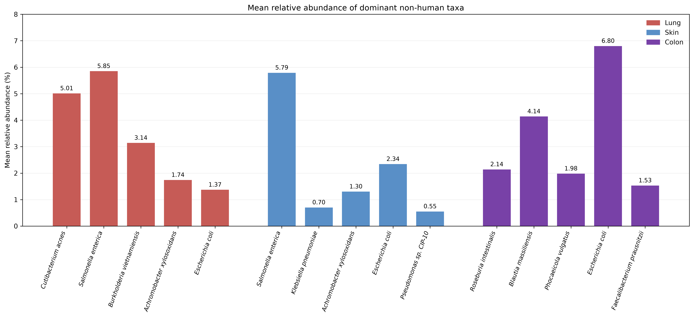
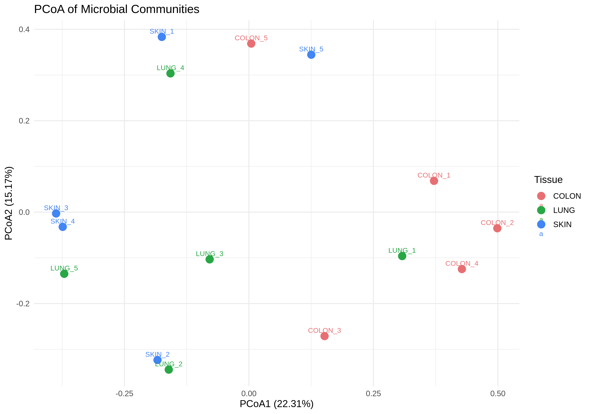

# 🧬 Microbial Signatures in Host-Unmapped Human RNA-seq Reads

## 🔎 Overview

This project develops a reproducible bioinformatics workflow for investigating microbial signatures in host-unmapped reads from human RNA-seq datasets.

Human RNA-seq datasets contain reads that may fail to align to the human reference genome. Rather than discarding these host-unmapped reads, this project examines them further using taxonomic classification and abundance estimation to investigate potential microbial signatures.

The workflow was developed in two stages. An initial single-sample pilot was used to establish and troubleshoot the local command-line workflow. The pipeline was then refined and scaled to analyse 15 human tissue RNA-seq samples from skin, lung and colon.

## 🧪 Project Rationale

Human RNA-seq studies are primarily designed to investigate host gene expression. During alignment to a human reference genome, however, a proportion of reads may remain unmapped. These reads are often excluded from host-focused downstream analyses, but they may contain additional biological information that can be investigated further.

This project investigates whether host-unmapped RNA-seq reads can be characterised to identify potential microbial signatures in human tissue transcriptomic datasets. Taxonomic classification and abundance estimation are used to examine the microbial taxa represented within these reads while recognising that host-unmapped reads are not necessarily microbial in origin.

## ⚙️ Workflow Development

The workflow was first established using a single RNA-seq sample as a pilot. This initial implementation was used to test the major stages of the pipeline, identify computational and methodological challenges, and determine the refinements required before scaling the analysis to the full 15-sample dataset.

## Pilot Workflow

The pilot workflow processed a single-end RNA-seq sample through quality control, read preprocessing, host alignment, microbial taxonomic classification and abundance estimation. FastQC v0.12.1 was used for read quality assessment, fastp v1.3.7 for preprocessing, HISAT2 v2.2.3 for alignment against the human reference genome, Kraken2 v2.17.1 for taxonomic classification of host-unmapped reads, and Bracken v3.0.1 for species-level abundance estimation. MultiQC v1.35 was used to aggregate and summarise quality-control and pipeline reports.

Pilot workflow:

## Pilot Sample

The pilot workflow was implemented using SRR7961304 (SKIN_3), a 50 bp single-end human skin RNA-seq sample included in the full 15-sample dataset. This sample was selected to establish and troubleshoot the local command-line implementation of the workflow before scaling the pipeline across the complete dataset. The pilot therefore serves as an initial implementation stage rather than a separate analysis from the full study.

## Pilot Observations and Limitations
The pilot successfully established the major stages of the local workflow but also identified areas requiring refinement before multi-sample analysis. In particular, Kraken2 classification using the Standard-Full database was computationally demanding on the available local hardware, resulting in a substantial runtime. Processing this single sample took almost three days, substantially longer than expected, with Kraken2 classification against the Standard-Full database posing a major computational bottleneck. The pilot therefore highlighted the need to revise the Bash workflow and improve its handling of computationally demanding steps before scaling microbial classification to all 15 samples. The experience informed subsequent script modifications and a more practical multi-sample execution strategy; it did not eliminate the inherent computational cost of Kraken2.

The pilot also informed several methodological refinements for the full analysis. This repository extends a microbial-signature analysis of host-unmapped human RNA-seq reads originally undertaken as part of an MSc research project into a reproducible local command-line workflow. The full 15-sample analysis implemented the original MSc preprocessing approach, using Falco for quality control and Trimmomatic for read preprocessing. Quality control was also performed on the host-unmapped reads before they proceeded to microbial taxonomic classification. In addition, the Bash pipeline was expanded to support both single-end and paired-end RNA-seq data, applying the appropriate processing commands according to the sequencing layout of each sample.

---

## From MSc Dissertation to Local Implementation
The initial investigation was undertaken for an MSc research dissertation using **Galaxy** for bioinformatics processing and **RStudio** for downstream statistical analysis and visualisation. This repository documents the subsequent local implementation and reproduction of the analysis using **Ubuntu Linux**, **Bash**, **Python** and **R**. The aim was to make the processing steps more transparent, scriptable and reproducible, while retaining the biological research question. Where the locally reconstructed analysis differs from the dissertation, those results are distinguished below rather than treated as interchangeable.

### Refined 15-Sample Workflow
Building on the pilot, the refined workflow processed the complete 15-sample dataset comprising five skin, five lung and five colon tissue RNA-seq samples. The workflow retained host alignment with HISAT2 followed by taxonomic classification and abundance estimation with Kraken2 and Bracken, while incorporating the preprocessing, quality-control and sequencing-layout refinements identified above.

Refined workflow:

---

## 🧫 Dataset
The full analysis comprises 15 human tissue RNA-seq samples, with five biological samples representing each of three tissue groups: skin, lung and colon. The dataset includes both single-end and paired-end sequencing layouts, which were handled through the corresponding pathways in the refined Bash pipeline.

### Sample Information
| Sample ID | SRA Accession | Tissue | Read Length | Layout |
|---|---|---|---|---|
| SKIN_1 | SRR7961333 | Skin | 50 bp | Single-end |
| SKIN_2 | SRR7961317 | Skin | 50 bp | Single-end |
| SKIN_3 | SRR7961304 | Skin | 50 bp | Single-end |
| SKIN_4 | SRR7961281 | Skin | 50 bp | Single-end |
| SKIN_5 | SRR33915754 | Skin | 75 bp | Single-end |
| COLON_1 | SRR7961292 | Colon | 50 bp | Single-end |
| COLON_2 | SRR7961262 | Colon | 50 bp | Single-end |
| COLON_3 | SRR7961278 | Colon | 50 bp | Single-end |
| COLON_4 | SRR7961254 | Colon | 50 bp | Single-end |
| COLON_5 | SRR2012208 | Colon | 76 bp | Paired-end |
| LUNG_1 | SRR7961222 | Lung | 50 bp | Single-end |
| LUNG_2 | SRR7961255 | Lung | 50 bp | Single-end |
| LUNG_3 | SRR7961291 | Lung | 50 bp | Single-end |
| LUNG_4 | SRR7961223 | Lung | 50 bp | Single-end |
| LUNG_5 | SRR7961221 | Lung | 50 bp | Single-end |

## 🛠️ Tools and Software
The refined 15-sample workflow was implemented locally in Ubuntu using the following bioinformatics and statistical software:

•	**Falco v2.0.2** – quality assessment of raw, trimmed and host-unmapped RNA-seq reads.
•	**Trimmomatic v0.41** – read preprocessing and quality trimming.
•	**HISAT2 v2.2.3** – alignment to the human reference genome and extraction of host-unmapped reads.
•	**Kraken2 v2.17.1** – taxonomic classification of host-unmapped reads.
•	**Bracken v3.0.1** – species-level abundance estimation.
•	**R v4.6.1** – downstream microbial community and statistical analysis.
•	**vegan v2.7-5** – Bray-Curtis dissimilarity, PERMANOVA and PERMDISP analyses.
•	**ggplot2 v4.0.3** – visualisation of microbial community patterns, including PCoA.

## 📊 Analysis and Results

### Data processing and microbial abundance
The completed local workflow processed 15 biological RNA-seq samples: five each from skin, lung and colon. Following quality assessment, trimming and host alignment, host-unmapped reads were investigated using Kraken2 and Bracken. Homo sapiens assignments were retained during Kraken2 classification and Bracken estimation; they were excluded from the downstream non-human abundance matrix used for community analysis.

The locally reconstructed abundance table contains **30 non-human taxa** across 15 biological samples. This is distinct from the **29-non-human taxa matrix** used in the original dissertation analysis. The paired-end colon sample (COLON_5) required the two read files to be handled within the paired-end workflow and its downstream abundance results combined for the biological sample.

### Mean relative abundance of selected taxa

*Figure 1. Mean relative abundance of selected microbial taxa across skin, lung and colon tissues, based on Bracken-derived values reported in the original MSc dissertation. Human assignments are not displayed, and percentages were not re-normalised after their exclusion.*

### Principal coordinates analysis (PCoA)

*Figure 2. Principal coordinates analysis (PCoA) of Bray–Curtis dissimilarities across 15 RNA-seq samples from skin, lung and colon tissues. PCoA1 and PCoA2 explained 22.31% and 15.17% of the variation, respectively.*

### Community-level statistical results
The table below compares the original MSc dissertation results with the locally reconstructed analysis. The differences reflect the use of different abundance matrices (29 versus 30 taxa).

| Analysis | MSc dissertation (29 taxa) | Local reconstruction (30 taxa) |
|---|---:|---:|
| PCoA axis 1 | 22.57% | 22.31% |
| PCoA axis 2 | 14.31% | 15.17% |
| Overall PERMANOVA *p* | 0.018 | 0.045 |
| Overall PERMANOVA R² | 0.2193 | 0.20738 |
| Skin vs colon, pairwise *p* | 0.006 | 0.026 |
| Lung vs colon, pairwise *p* | 0.035 | 0.034 |
| Skin vs lung, pairwise *p* | 0.589 | 0.577 |
| PERMDISP *p* | 0.948 | 0.939 |

Both analyses suggested tissue-associated differences in inferred microbial profiles, with colon differing from skin and lung, whereas skin and lung were not significantly different in the pairwise comparisons.

### Interpretation of Findings

The colon samples showed the most biologically plausible microbial profiles, with recognised gut-associated taxa including *Roseburia intestinalis*, *Blautia massiliensis*, *Phocaeicola vulgatus* and *Faecalibacterium prausnitzii*. These findings are broadly consistent with established body-site differences in microbial communities (Human Microbiome Project Consortium, 2012).

In contrast, lung and skin samples exhibited more heterogeneous microbial signatures, including taxa not typically dominant in these tissues. Their greater overlap in the PCoA was consistent with the non-significant lung–skin pairwise PERMANOVA result.

Both the original dissertation and locally reconstructed analyses identified significant tissue-associated differences, particularly between colon and the other two tissue groups. PERMDISP did not identify significant differences in within-group dispersion.

Overall, the results suggest that host-unmapped RNA-seq reads can provide additional microbial sequence information. However, detected taxa should not automatically be interpreted as viable or resident microorganisms.

## 🔁 Reproducibility and Repository Contents
The repository brings together the command-line workflow, downstream analysis scripts, selected summaries and figures. The main analysis components include:

| Component | Purpose |
|---|---|
| `microbial_pipeline.sh` | Bash workflow for RNA-seq preprocessing, host alignment and microbial classification/abundance steps |
| `microbial_abundance.py` | Python processing of Bracken reports into a combined microbial abundance table |
| `microbial_analysis.R` | R analysis of microbial community dissimilarities, ordination and statistical comparisons |
| `samples.txt` | Sample accession list |
| `results/` | Selected abundance tables, statistics, read summaries and figures |
| `qc/` | Selected quality-control summaries and reports |

The full reference genomes, Kraken2 databases and large raw sequencing files are not intended to be stored in this GitHub repository. Reproduction requires appropriate input datasets, reference files, database resources and compatible software environments. The exact computational requirements depend on the reference database and hardware available.

---

### Research Implications and Future Directions

This study demonstrates the potential value of recovering microbial sequence information from host-unmapped RNA-seq reads, extending the usefulness of datasets originally generated for human transcriptomic analysis. Previous studies have similarly demonstrated that unmapped RNA-seq reads can contain additional biological information (Simon et al., 2018; Chen et al., 2020).

Future investigations could strengthen this approach through:

- **Human pangenome references:** Evaluate whether more genetically diverse human references improve host-read identification (Liao et al., 2023).
- **De novo assembly:** Assemble unclassified reads into longer contigs for taxonomic and functional characterisation, potentially identifying sequences poorly represented in reference databases (Shafranskaya et al., 2022).
- **Independent validation:** Compare RNA-seq-derived microbial signatures with matched microbiome-focused sequencing data to assess their reliability and biological relevance.

These approaches represent future research opportunities rather than analyses completed across the full dataset.

## ⚠️ Limitations and Interpretation

### Pilot-stage computational limitations
The first local pilot revealed that microbial classification with the Kraken2 Standard-Full database could be highly demanding on the available computer. Processing one sample took almost three days, prompting revisions to the Bash script and the strategy for running the complete dataset. This pilot experience is part of the workflow-development process, rather than a biological finding.

### Scientific and analytical limitations
•	**Residual human reads**: Failure to map to one human reference does not guarantee that a read is microbial. Some human-derived sequences may remain in the unmapped fraction.
•	**Contamination and misclassification**: Environmental, reagent or handling contamination and database-related classification errors can produce apparent microbial signatures.
•	**Small sample size**: Five biological samples per tissue limits statistical power and generalisability.
•	**Tissue interpretation**: Taxa observed in skin or lung, including taxa more commonly associated with other habitats, require cautious interpretation and independent validation.
•	**Reference and database dependence**: Host alignment parameters and microbial reference database composition can affect the resulting classifications.
•	**Reconstruction differences**: The local 30-taxon abundance matrix and the original dissertation's 29-taxon matrix are not identical; their statistical outputs should not be described as an exact numerical reproduction.

--

## 🎯 Project Significance
This project demonstrates the development of a bioinformatics analysis from an initial MSc study into a local, script-based implementation. It includes troubleshooting of computational bottlenecks, handling of single-end and paired-end RNA-seq data, host-read depletion, microbial classification, abundance processing and statistical interpretation in R.

**The microbial signatures reported here are exploratory and require further validation; they should not be interpreted as clinical diagnoses**.

## Selected References

1. Human Microbiome Project Consortium (2012). Structure, function and diversity of the healthy human microbiome. *Nature*, 486, 207–214. https://doi.org/10.1038/nature11234

2. Simon, L.M. et al. (2018). MetaMap: An atlas of metatranscriptomic reads in human disease-related RNA-seq data. *GigaScience*, 7(6), giy070. https://doi.org/10.1093/gigascience/giy070

3. Chen, S. et al. (2020). CAFU: A Galaxy framework for exploring unmapped RNA-Seq data. *Briefings in Bioinformatics*, 21(2), 676–686. https://doi.org/10.1093/bib/bbz018

4. Liao, W.-W. et al. (2023). A draft human pangenome reference. *Nature*, 617, 312–324. https://doi.org/10.1038/s41586-023-05896-x

5. Shafranskaya, D. et al. (2022). MetaGT: A pipeline for de novo assembly of metatranscriptomes with the aid of metagenomic data. *Frontiers in Microbiology*, 13, 981458. https://doi.org/10.3389/fmicb.2022.981458
